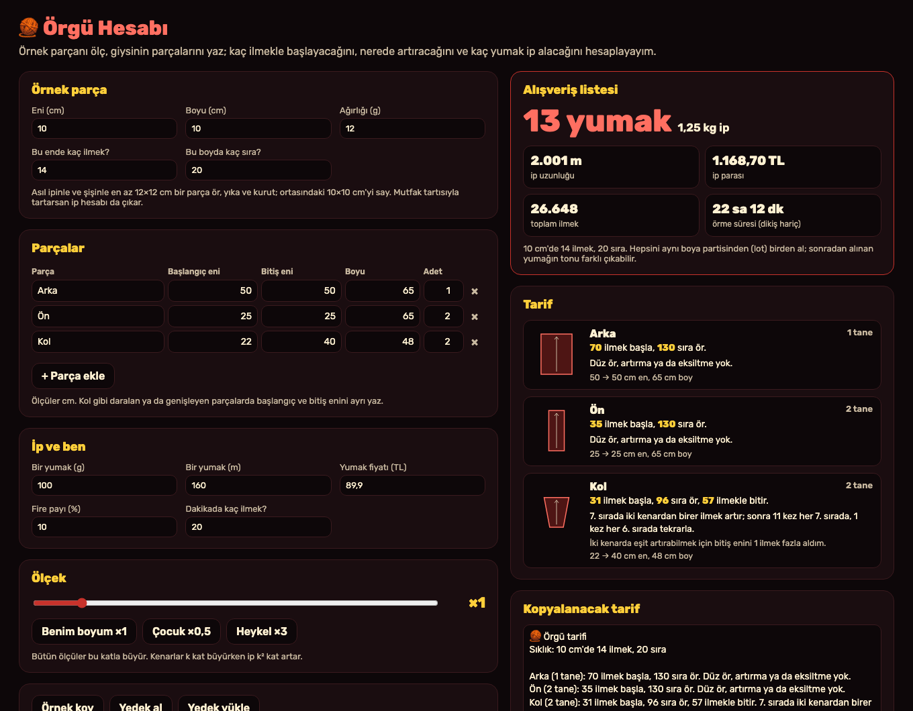
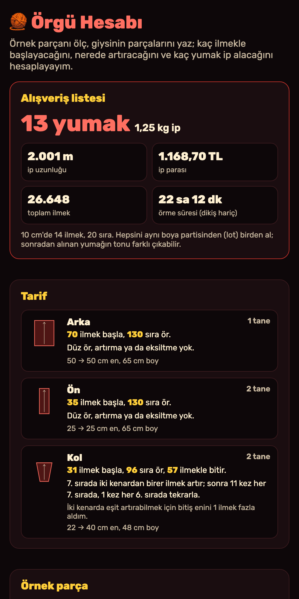

# 🧶 Örgü Hesabı

Aklıma bu geldi: bir hırka örmeye başlarken hep aynı sorular çıkıyor. Kaç ilmekle başlayacağım? Kol genişlerken hangi sıralarda ilmek artıracağım? Kaç yumak ip almalıyım? Ben bunları örnek parçadan hesaplayan küçük bir sayfa yaptım. Bir heykele dev bir hırka örmek istersem ölçeği büyütüyorum, ip miktarı da ona göre çıkıyor.

## Ben nasıl kullanıyorum?

1. Klasörde `python3 -m http.server 8000` komutunu çalıştırıp tarayıcıda `http://localhost:8000` adresini açıyorum. (`?ornek` eklersem uydurma örnek açılıyor.)
2. Asıl ipim ve şişimle küçük bir **örnek parça** örüyorum. Ortasındaki 10×10 cm'de kaç ilmek ve kaç sıra olduğunu sayıyorum, parçayı mutfak tartısında tartıyorum.
3. **Parçalar** tablosuna giysinin parçalarını yazıyorum: başlangıç eni, bitiş eni, boyu ve kaç tane olduğu. Kol gibi genişleyen parçalarda iki en farklı oluyor.
4. **İp ve ben** kısmına yumağın gramını, metresini, fiyatını, fire payını ve dakikada kaç ilmek ördüğümü yazıyorum.
5. Sağda kaç yumak ip alacağımı ve her parçanın tarifini görüyorum: kaç ilmekle başlayacağım, kaç sıra öreceğim ve hangi sıralarda artırıp eksilteceğim. **📋 Kopyala** ile tarifi telefonuma atıyorum.
6. **Ölçek** ile her şeyi büyütüp küçültüyorum: çocuk için ×0,5, bir heykel için ×3.

Her şey sadece kendi tarayıcımda duruyor. İstersem **Yedek al** ile JSON dosyası olarak saklayıp sonra geri yüklüyorum.

## Ben içeride ne yaptım?

- `core.mjs` bütün hesabı yapıyor, `app.mjs` sadece ekranı çiziyor.
- Örnek parçadan sıklığı buluyorum: 1 cm'de kaç ilmek, kaç sıra; 1 cm² örgü kaç gram.
- Her parçanın ilmek sayısını en × ilmek sıklığı, sıra sayısını boy × sıra sıklığı ile buluyorum.
- Artırma ve eksiltmeyi iki kenarda simetrik yapıyorum. Bu yüzden başlangıç ile bitiş arasındaki fark çift olmalı. Fark tek çıkarsa bitiş enini hedefe en yakın çift farka yuvarlıyorum ve bunu tarifte yazıyorum.
- **Artırma planı:** R sırada d kez artırma yapılacaksa sırayı d + 1 eşit parçaya bölüyorum. Son parça düz kalıyor. Parçalar ya a ya da a + 1 sıra uzunluğunda oluyor, uzun olanlar başta. Böylece tarif örgü kitaplarındaki gibi en fazla iki blok oluyor: "7. sırada başla; sonra 11 kez her 7. sırada, 1 kez her 6. sırada tekrarla."
- İp: parçaların alanı (yamuk alanı) × örnek parçanın cm² başına ağırlığı × (1 + fire). Yumak sayısını yukarı yuvarlıyorum.
- Ölçek bütün ölçüleri çarpıyor. Kenarlar k kat büyürken alan ve ip k² kat büyüyor.

## Ben neyi sınadım?

Ben `node test.mjs` komutunu çalıştırdım. **51 kontrol** geçti.

- Artırma dağıtımını **2000 rastgele durumda** denedim:
  - Değişiklik sayısı her zaman doğru çıktı.
  - Hepsi farklı sıralara, artan sırayla düştü.
  - Aralıklar birbirinden en fazla 1 sıra farklı.
  - Tarif hiçbir zaman ikiden fazla bloğa bölünmedi.
- Her parçada başlangıç ilmeği + 2 × artırma sayısı tam olarak bitiş ilmeğini veriyor; eksiltmede de tersi.
- Örnek hırkada (kalın ip, 10 cm'de 14 ilmek ve 20 sıra, 10×10 cm örnek parça 12 g):
  - Arka 70 ilmek ve 130 sıra.
  - Önler 35'er ilmek.
  - Kollar 31 ilmekle başlayıp 96 sırada 57 ilmeğe çıkıyor.
  - Toplam **1,25 kg ip, 13 yumak**, yaklaşık 2001 m; 26.648 ilmek, dakikada 20 ilmekle yaklaşık 22 saat.
- Ölçek ×3 olunca ip yaklaşık **9 kat** artıyor: 113 yumak, 11,26 kg.
- Örnek parçanın ağırlığı yoksa ip hesaplanmıyor ama ilmek tarifi yine çıkıyor. Yumak tam bölünüyorsa fazladan yumak eklenmiyor.
- Çok kısa bir parçada çok fazla artırma istenirse uyarı çıkıyor.

Denerken bir sorun buldum. İlk sürümde artırmaları matematik olarak en eşit şekilde yayıyordum. Sonuç doğruydu ama tarif "2 kez her 7. sırada, 1 kez her 6. sırada, 6 kez her 7. sırada, 1 kez her 6. sırada…" diye uzayıp gidiyordu. Heykel boyunda ise otuzdan fazla parçaya bölünüyordu, örerken takip etmek imkânsızdı. Ben dağıtımı örgü tariflerindeki iki bloklu kurala çevirdim. Aralıklar hâlâ en fazla 1 sıra farklı ama tarif tek satırda okunuyor.

Ben uygulamayı tarayıcıda da açtım. Ölçek düğmelerini, ağırlığı silmeyi, hatalı girişin kırmızı olmasını, parça ekleyip silmeyi, kısa parça uyarısını ve isimlerdeki özel karakterlerin güvenle gösterilmesini denedim. Telefon boyutunda (375 piksel) sayfa yana taşmadı. Telefonda alışveriş listesi ve tarif en üstte çıkıyor.

Benim sınırlarım var:

- Parçaları yamuk sayıyorum. Kol oyuntusu, yaka oyuntusu ve omuz eğimi gibi kıvrımlar bu hesapta yok; onlar için parçayı birkaç yamuğa bölmek gerekiyor.
- Artırmaları her sırada sayıyorum. Bazı tarifler sadece düz yüzden örülen sıralarda artırır, o zaman sayıları ona göre ayarlamak gerekir.
- İp hesabı, örnek parçayla aynı örgü deseninin kullanıldığını varsayıyor. Saç örgüsü ya da kabartma desen çok daha fazla ip yer.
- Dikiş, düğme patı ve ilmekleri toplayıp örülen kenarlar hesapta yok. Fire payı biraz bunun için var.
- Örnekteki ölçüler, ağırlık ve fiyat uydurma.

## Ben bunları nereden öğrendim?

- Örnek parça ve sıklık (gauge) ile ilmek hesaplama: örgü kitaplarındaki temel yöntem; örneğin Craft Yarn Council'ın standart ip ve sıklık tabloları.
- İki bloklu artırma kuralı: örgü tariflerinde kol artırmaları için kullanılan "her x. sırada, sonra her y. sırada" yazımı.
- Ölçekle alanın karesiyle büyümesi: benzer şekillerde alan oranı, kenar oranının karesidir (geometri).

## Ben bugünün kaynaklarına nasıl baktım?

Ben 17 Kasım 2026 saat 17.35 Türkiye vaktinde [GitHub Trending günlük listesine](https://github.com/trending?since=daily) baktım. Gördüğüm 15 repo arasında ilk sıradaki repo "bugün 1.007 yıldız" almıştı. Bu, bütün GitHub'ın kesin birincisi olduğu anlamına gelmez. Ben onların kodunu kopyalamadım.

Ben aynı anda [Trends24 dünya listesinde](https://trends24.in/) `パラグアイ` başlığını ilk sırada gördüm. Projeme zorla eklemedim. Bu liste üçüncü taraf bir anlık görünümdür; bütün günün kesin en çok konuşulan konusu demem.

Ben [Reddit r/popular Top/Today listesinde](https://www.reddit.com/r/popular/top/?t=day) ilk sırada r/MadeMeSmile'daki ["Someone crocheted a giant red cardigan and put it on the statue of Fred Rogers in Pittsburgh"](https://www.reddit.com/r/MadeMeSmile/comments/1xy5g3x/someone_crocheted_a_giant_red_cardigan_and_put_it/) gönderisini gördüm. Başlığı görünce aklıma bu proje geldi. O hırkanın ölçülerini ve kaç yumak ip harcandığını bilmiyorum; örnekteki sayıları ben uydurdum. Bu tek görünüm, bütün Reddit'in en çok konuşulan konusunu kanıtlamaz.

Ben bu projeyi MIT lisansı ile paylaşıyorum.
